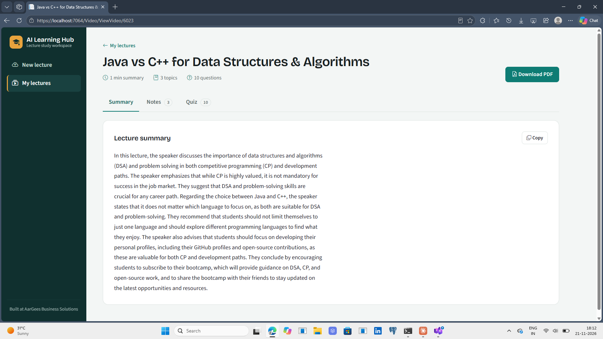
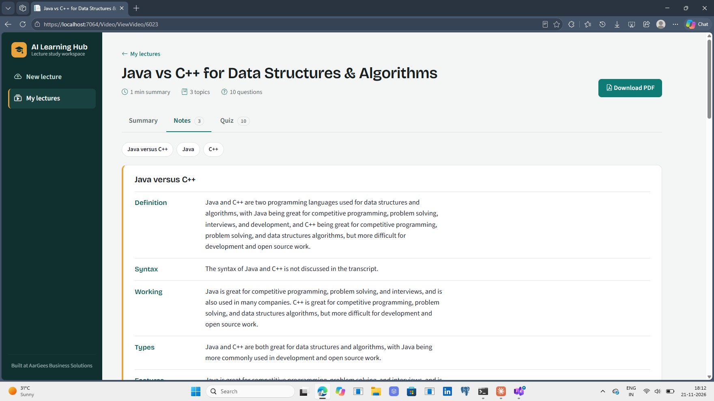
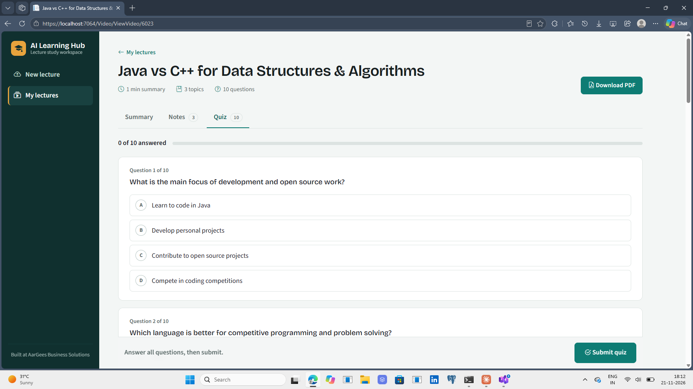
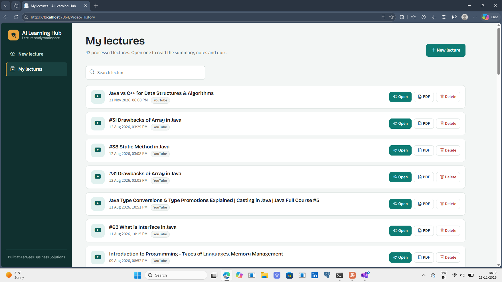

# AI Learning Hub

**Developed by S M Kruthika** | AIML engineering student | Internship project at AarGees Business Solutions

I designed and built AI Learning Hub, a web-based learning platform that turns lecture videos and YouTube links into study material. You upload a recording or paste a link, and the app produces a summary, structured revision notes and a multiple-choice quiz with instant scoring. The language model runs locally on the machine, so no lecture data is sent to an outside service.


## What it does

- Accepts a lecture video file or a YouTube link.
- Converts the speech to a text transcript.
- Generates a readable summary of the whole lecture.
- Generates revision notes split by topic, with headings such as Definition, Syntax, Example and Key Points, included only when the lecture covers them.
- Generates a multiple-choice quiz (5, 10 or 15 questions depending on lecture length) and scores the student's answers.
- Saves every processed lecture, so it can be reopened, exported as a PDF, or deleted from the history page.
- Recognises a lecture that was already processed and opens the saved result instead of processing it again.

## Screenshots

| Processing | Summary |
|---|---|
| ![Processing] |  |

| Notes | Quiz |
|---|---|
|  |  |

| Score and review | My lectures |
|---|---|
| ![Score] |  |

## My role

I developed the complete application:

- The ASP.NET Core MVC backend, database design and Entity Framework Core data layer.
- The Python scripts for transcription and content generation, and their integration with the C# backend.
- The validation layer that checks the language model's output before it is used.
- The responsive Razor, Bootstrap and CSS frontend.
- Testing of each stage, from upload to the result page.

## How it works

```
Video file / YouTube link
        |
        v
  yt-dlp (links only) -> audio
        |
        v
  Faster-Whisper -> transcript.txt
        |
        v
  Ollama + Qwen2.5:3B
     summary.py -> summary.json
     notes.py   -> notes.json
     quiz.py    -> quiz.json
        |
        v
  Pydantic validation at every step
        |
        v
  combine_results.py -> final_output.json
        |
        v
  ASP.NET Core MVC -> SQL Server (Entity Framework Core) -> Razor views
```

1. **Input.** The ASP.NET Core controller receives the upload or link and computes a hash to detect duplicates.
2. **Background job.** Processing takes minutes, so the controller starts a background job and returns a progress page straight away. The page polls a status endpoint and redirects to the result when the job finishes. This avoids request timeouts, including behind a tunnel or proxy.
3. **Python scripts.** The C# service runs each script as a separate process and captures its output and exit code. A lock lets only one lecture run at a time, because the scripts share files in the `AI` folder.
4. **Local language model.** `ollama_client.py` is the single place that talks to the Ollama API. It handles retries, the context window and output limits.
5. **Validation.** Small models sometimes return broken JSON. Every script validates its output with Pydantic (exactly four options per question, the answer must match an option, no duplicate questions, no empty fields). On failure the script retries with a slightly higher temperature, because retrying at temperature 0 would just repeat the same mistake.
6. **Storage and display.** The result is saved with Entity Framework Core and shown in Razor views.

## Tech stack

| Area | Technology |
|---|---|
| Backend | C#, ASP.NET Core MVC, Entity Framework Core |
| Database | Microsoft SQL Server |
| Frontend | Razor views, Bootstrap, Bootstrap Icons, custom CSS and JavaScript |
| Speech to text | Faster-Whisper |
| Language model | Qwen2.5:3B running locally through Ollama |
| Validation | Pydantic |
| Media | yt-dlp, FFmpeg |

## Project structure

```
ai-learning-hub/
  README.md
  LMS.sln
  docs/screenshots/          Images used in this README
  LMS/                       The ASP.NET Core project
    AI/                      Python scripts
      ollama_client.py       Shared Ollama client (retries, JSON extraction)
      models.py              Pydantic models for every output
      transcribe.py          Faster-Whisper transcription
      download_audio.py      YouTube audio download
      summary.py             Summary generation
      notes.py               Revision notes generation
      quiz.py                Quiz generation and validation
      combine_results.py     Merges summary, notes and quiz into one JSON file
    Controllers/             MVC controllers
    Services/                Background processing, hashing, PDF export
    Models/                  Database entities and response classes
    ViewModels/              View models
    Views/                   Razor views
    wwwroot/                 CSS, JavaScript, static files
    Program.cs
    appsettings.json
```

## Run it locally

### Requirements

- .NET SDK (the version in `LMS/LMS.csproj`)
- SQL Server (Express or LocalDB is fine)
- Python 3.13
- [Ollama](https://ollama.com)
- FFmpeg, available on your PATH

### Setup

1. Clone the repository and open the project folder.
   ```
   git clone https://github.com/YOUR-USERNAME/ai-learning-hub.git
   cd ai-learning-hub/LMS
   ```
2. Install the Python packages.
   ```
   pip install faster-whisper requests pydantic yt-dlp
   ```
3. Download the language model.
   ```
   ollama pull qwen2.5:3b
   ```
4. Open `appsettings.json` and check two values:
   - `ConnectionStrings:DefaultConnection` points to your SQL Server.
   - `Python:Path` points to your `python.exe`.
5. Start the app. The database and tables are created on first start.
   ```
   dotnet run --urls http://localhost:5000
   ```
6. Open `http://localhost:5000`.

The app starts Ollama automatically if it is not already running.

### Test the Python scripts on their own

Put a lecture transcript in `LMS/AI/transcript.txt`, then from the `LMS/AI` folder run:

```
python summary.py
python notes.py
python quiz.py
python combine_results.py
```

Each script prints "generated successfully" when it works.

## Limitations

- Processing runs on the CPU, so a long lecture can take several minutes.
- Only one lecture is processed at a time. Others wait in a queue.
- A 3B model can make mistakes. Summaries, notes and quiz questions should be checked before relying on them.
- There is no user login. This is a single-user project meant to run on one machine.

## What I learned

- Running a local language model and making its output reliable with schema validation and retries.
- Integrating Python scripts with an ASP.NET Core backend through process execution.
- Using background jobs and status polling for work that takes minutes.
- Designing a responsive interface with Razor and Bootstrap.

## Author

S M Kruthika
AIML engineering student
[LinkedIn](www.linkedin.com/in/s-m-kruthika) | [Email](smkruthika10@gmail.com)

Developed as an internship project at AarGees Business Solutions.